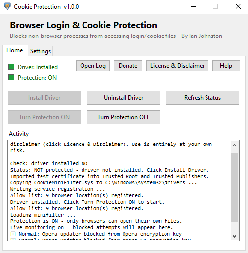

# Cookie Protection

**Stops infostealer malware stealing your browser login & cookie files - Windows 10 & 11 (64-bit).**

By Ian Johnston Engineering Limited - [www.ianjohnston.com](https://www.ianjohnston.com/index.php/projects/cookieprotection)

> **Status:** not yet released. The kernel driver is waiting to be signed by Microsoft. Downloads will appear under **Releases** when it's ready.

## What it does

Infostealer malware doesn't need your passwords. It copies your browser's cookie and login files and uses the session cookies inside them to log straight into your accounts - bypassing your password and two-factor authentication.

Cookie Protection installs a small Windows kernel **file-system minifilter driver** that only lets genuine browsers open their own cookie, login and encryption-key files. Any other program that tries - malware included - is blocked and the attempt is logged. Unlike file permissions, this works even against malware running under your own user account.

**Supported browsers:** Chrome, Edge, Brave, Vivaldi, Opera, Opera GX and Firefox.

## Features

- Blocks non-browser programs from reading browser cookies, saved passwords, autofill data and encryption keys.
- Full-path browser allow-list - renamed or copied fake browsers are blocked too.
- Blocks browsers started in headless or remote-debugging mode.
- Blocks copying the files through a network share, and renaming or hard-linking them to get round the check.
- Live Activity box and log.txt, with origin details for every real attack (path, command line, parent process, signature, SHA-256 / VirusTotal link, download source).
- Tray notifications and a coloured status dot.
- Per-browser and per-file-type settings, plus a built-in Self-Test.
- Tamper resistant - the driver can't be unloaded, stopped or reconfigured except through the app.

## Requirements

- Windows 10 or 11, 64-bit
- .NET Framework 4.8 (already part of Windows 10 & 11)
- Administrator rights to install

## Installing

1. Download the zip from **Releases**, extract it and run `CookieProtection.msi`.
2. Open Cookie Protection from the desktop shortcut.
3. Click **Install Driver**, then **Turn Protection ON**.

Protection is **off after every Windows restart** - open the app and turn it on again. Closing the app doesn't stop protection, but nothing is logged until it's reopened.

To uninstall, use Windows Settings > Apps. The uninstaller turns protection off and removes the driver.

## Notes

- Some normal programs - Windows' SysMain, Microsoft Defender, and Opera's and Vivaldi's own helpers - read browser files now and then. They're blocked harmlessly and shown as **ℹ Normal**, with no pop-up.
- Not a replacement for antivirus.

Full details, the technical side and how it's been tested: [ianjohnston.com - Cookie Protection](https://www.ianjohnston.com/index.php/projects/cookieprotection)

## Discuss

Questions, suggestions and bug reports are welcome on the [EEVBlog forum](https://www.eevblog.com/forum/security/cookie-protection-a-windows-kernel-driver-that-blocks-cookie-theft/) or via the [contact page](https://www.ianjohnston.com/index.php/contact).

## Licence

Free for **personal, non-commercial use only**. Use within businesses and organisations needs a separate commercial licence - please get in touch. See [LICENSE.txt](LICENSE.txt).

The source code is not published at this time.

Windows, Microsoft Edge, Google Chrome, Mozilla Firefox, Opera, Brave, Vivaldi and other product names are trademarks of their respective owners. Cookie Protection is not affiliated with or endorsed by any of them.
